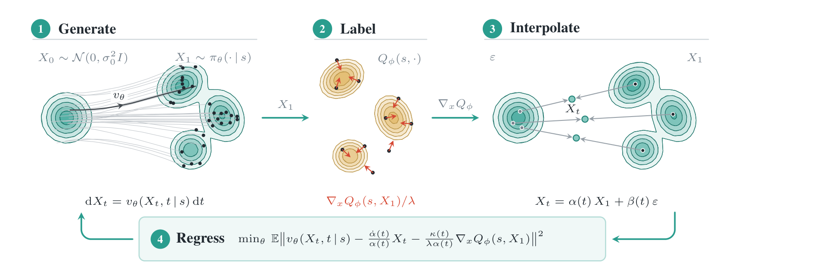

# Reinforcement Learning via Fixed-point Flow Matching

Denis Blessing, Onur Celik, Gerhard Neumann — Autonomous Learning Robots Lab (ALR),
Karlsruhe Institute of Technology (KIT)

[Paper](https://arxiv.org/abs/2610.12848) · [Project page](https://denisbless.github.io/FFM_website/)

Official code for **Fixed-point Flow Matching (FFM)**: a data-free procedure for training and
fine-tuning flow policies in RL.

<p align="center">
  
</p>

In maximum-entropy and behaviour-constrained RL the optimal policy is a Boltzmann distribution.
FFM trains a flow policy towards it with a flow-matching-style regression whose target is read off
the critic instead of a dataset. One policy-improvement step is: **(1)** generate clean actions
with the current flow (forward only, no gradients); **(2)** label them with the critic's action
gradient ∇ₐQ; **(3)** noise them along the interpolant X_t = α(t)·X₁ + β(t)·ε; **(4)** regress the
velocity field onto the label. The optimal policy is a fixed point of this loop. There is no
backpropagation through the integrator, no importance weighting, and no conversion to a diffusion
model.

## Repository layout

The paper's two experimental settings are two self-contained projects:

| folder | setting | benchmark | stack |
|---|---|---|---|
| [`offline2online/`](offline2online) | offline-to-online fine-tuning of a BC-pretrained flow policy | OGBench: 10 domains × 5 tasks | JAX / Flax, pip, Python 3.11 |
| [`online/`](online) | on-policy maximum-entropy RL from scratch | MuJoCo Playground: 20 DMC tasks and 4 MJX humanoid joystick tasks | JAX / Flax NNX, uv, Python 3.12 |

The two projects pin different JAX versions, so install each into its own environment. The README
in each folder covers installation, the exact commands behind the paper's numbers, and a code map.

Offline-to-online on OGBench ([`offline2online/README.md`](offline2online/README.md)):

```bash
cd offline2online
pip install "jax[cuda12]" && pip install -r requirements.txt
python scripts/download_datasets.py cube-double
scripts/run_bc.sh cube-double 10001          # BC reference policy
scripts/run_ffm.sh cube-double 3 10001       # FFM offline -> online on task 3
```

Online RL from scratch on MuJoCo Playground ([`online/README.md`](online/README.md)):

```bash
cd online
uv sync
uv run python src/jaxrl/ffm_submission.py env.name=CheetahRun seed=0
```

## Citation

```bibtex
@misc{blessing2026reinforcementlearningfixedpointflow,
  title={Reinforcement Learning via Fixed-point Flow Matching},
  author={Denis Blessing and Onur Celik and Gerhard Neumann},
  year={2026},
  eprint={2610.12848},
  archivePrefix={arXiv},
  primaryClass={cs.LG},
  url={https://arxiv.org/abs/2610.12848},
}
```

## License

MIT — see [`LICENSE`](LICENSE). The offline-to-online code is adapted from the TRQAM codebase and
the online code from the REPPO codebase, both MIT; their notices are retained in `LICENSE` and
[`online/LICENSE`](online/LICENSE).
